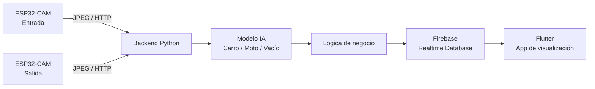

# Parking IA — Reconstrucción, arquitectura y fases del proyecto

# Resumen del proyecto

<aside>
🅿️

**Parking IA / Parqueadero Inteligente Automatizado (P.I.A.)** es un sistema de conteo y visualización de cupos para carros y motos usando cámaras ESP32-CAM, un modelo de visión por computadora, un backend Python, Firebase Realtime Database y una aplicación Flutter.

</aside>

## Objetivo del MVP

Construir una maqueta funcional donde dos cámaras identifiquen vehículos en la **entrada** y la **salida**, el backend determine si la imagen corresponde a **Carro**, **Moto** o **Vacío**, actualice el estado del parqueadero y la aplicación Flutter muestre los cupos disponibles en tiempo real.

### Regla principal de negocio

- Cámara de **entrada** + Carro → incrementa carros ocupados.
- Cámara de **salida** + Carro → decrementa carros ocupados.
- Cámara de **entrada** + Moto → incrementa motos ocupadas.
- Cámara de **salida** + Moto → decrementa motos ocupadas.
- Predicción **Vacío** → no modifica el contador.
- El contador nunca debe superar la capacidad máxima ni bajar de cero.

---

# Arquitectura propuesta



### Responsabilidad por componente

| Componente | Responsabilidad |
| --- | --- |
| ESP32-CAM | Capturar imágenes y enviarlas al backend. No ejecutar la IA en el MVP. |
| Modelo IA | Clasificar cada imagen como Carro, Moto o Vacío. |
| Backend Python | Recibir imágenes, ejecutar inferencia, aplicar reglas y registrar eventos. |
| Firebase RTDB | Guardar configuración, estado actual, cámaras y eventos. |
| Flutter | Visualizar cupos, ocupación, disponibilidad y eventos recientes. |

---

# Estructura del proyecto

```
parking-ia/
├── README.md
├── AGENTS.md
├── .gitignore
│
├── docs/
│   ├── constitution.md
│   ├── architecture.md
│   └── requirements.md
│
├── backend/
│   ├── app/
│   ├── models/
│   ├── tests/
│   └── requirements.txt
│
├── firmware/
│   ├── entrada/
│   │   └── parking_entrada.ino
│   └── salida/
│       └── parking_salida.ino
│
├── ml/
│   ├── dataset/
│   │   ├── carro/
│   │   ├── moto/
│   │   └── vacio/
│   ├── model/
│   └── training/
│
└── mobile/
    └── parking_app/
```

<aside>
🔐

**Nunca subir al repositorio:** contraseñas Wi-Fi, `serviceAccountKey.json`, claves privadas de Firebase, tokens o credenciales. Deben quedar excluidos por `.gitignore` y manejarse mediante variables de entorno o archivos locales.

</aside>

---

# Plan de reconstrucción por fases

## Fase 1 — Base y documentación del proyecto

**Objetivo:** reconstruir el proyecto de manera ordenada antes de volver a escribir toda la lógica.

- [ ]  Crear repositorio `parking-ia`.
- [ ]  Crear estructura de carpetas.
- [ ]  Crear `README.md`.
- [ ]  Crear `AGENTS.md`.
- [ ]  Crear documentación de arquitectura y requisitos.
- [ ]  Configurar `.gitignore`.
- [ ]  Definir capacidades iniciales para carros y motos.
- [ ]  Definir nombres de cámaras: `entrance-01` y `exit-01`.

**Criterio de salida:** repositorio inicial listo y arquitectura documentada.

---

## Fase 2A — Configurar la ESP32-CAM como capturadora

**Decisión importante:** las fotografías del dataset se tomarán con las **mismas ESP32-CAM que se utilizarán en producción**, para que el modelo aprenda imágenes con la misma lente, resolución, compresión JPEG, ruido y perspectiva que recibirá después.

### Primera cámara: entrada

- [ ]  Configurar placa AI Thinker ESP32-CAM en Arduino IDE.
- [ ]  Configurar Wi-Fi.
- [ ]  Inicializar cámara correctamente.
- [ ]  Capturar imágenes JPEG.
- [ ]  Exponer temporalmente un endpoint tipo `/capture`.
- [ ]  Verificar desde navegador que la fotografía puede descargarse.
- [ ]  Definir resolución final de captura.
- [ ]  Definir calidad JPEG.
- [ ]  Mantener la misma configuración durante dataset e inferencia.

### Configuración inicial a evaluar

- Formato: JPEG.
- Resolución inicial recomendada para pruebas: VGA 640×480.
- Calidad JPEG: alrededor de 10–12.
- Frame buffer inicial: 1.

**Criterio de salida:** abrir la IP de la ESP32 y obtener consistentemente una imagen válida.

---

## Fase 2B — Herramienta para crear el dataset

**Objetivo:** evitar descargar cientos de imágenes manualmente.

Crear un pequeño script Python que consulte el endpoint `/capture` de la ESP32 y guarde automáticamente las imágenes en la clase correspondiente.

Ejemplo:

```
ESP32 /capture
      ↓
Script Python
      ↓
ml/dataset/
├── carro/
├── moto/
└── vacio/
```

El script deberá permitir seleccionar la clase antes de comenzar la captura y generar nombres consecutivos.

**Criterio de salida:** poder capturar varias imágenes y clasificarlas automáticamente en carpetas.

---

## Fase 2C — Construcción del dataset

### Clases

- **Carro**
- **Moto**
- **Vacío**

### Meta inicial

Aproximadamente **200–300 fotografías útiles por clase** para la primera versión.

No se trata de tomar cientos de fotografías idénticas. Se deben variar:

- ángulo,
- posición,
- distancia,
- orientación,
- pequeñas variaciones de iluminación,
- diferentes vehículos de juguete disponibles.

### Clase Vacío

Debe incluir también:

- piso vacío,
- sombras,
- cambios de iluminación,
- objetos cercanos,
- posibles reflejos,
- escenas donde no exista un vehículo válido.

### Usar las dos cámaras

Las imágenes de entrada y salida deben formar parte del dataset:

```
carro/
├── entrada_001.jpg
├── entrada_002.jpg
├── salida_001.jpg
└── salida_002.jpg
```

Así se evita entrenar únicamente para la perspectiva de una cámara.

### Separación entrenamiento / prueba

Reservar aproximadamente:

- **80 %** para entrenamiento.
- **20 %** para validación/prueba independiente.

Las imágenes de prueba no deben utilizarse para entrenar el modelo.

**Criterio de salida:** dataset balanceado y organizado para las tres clases.

---

## Fase 3 — Entrenamiento del modelo

Para reconstruir rápidamente el MVP se utilizará inicialmente **Google Teachable Machine — Image Project**.

### Flujo

1. Cargar imágenes de Carro, Moto y Vacío.
2. Entrenar el modelo.
3. Probarlo con ejemplos nuevos.
4. Exportar en formato TensorFlow/Keras.
5. Conservar el archivo del modelo dentro de `ml/model/`.

Modelo recuperado históricamente:

- `keras_model.h5`
- Entrada aproximada: 224×224×3.
- Clases: Carro, Moto, Vacío.

**Criterio de salida:** una imagen nueva produce una clasificación y confianza razonables.

---

## Fase 4 — Backend Python + IA

Tecnologías iniciales:

- Python
- Flask
- TensorFlow / Keras
- Pillow
- NumPy

### Primer endpoint

```
POST /api/v1/predict
```

Debe recibir una imagen y devolver algo similar a:

```json
{
  "prediction": "car",
  "confidence": 0.9432
}
```

### Diseño interno

Separar responsabilidades:

```
ImageClassifier
      ↓
ParkingService
      ↓
FirebaseRepository
```

No mezclar directamente la inferencia con las actualizaciones de Firebase.

**Criterio de salida:** el backend clasifica correctamente imágenes locales sin depender todavía de Firebase ni de la ESP32.

---

## Fase 5 — Comunicación ESP32 → Backend

La ESP32 debe enviar la imagen por HTTP.

El backend necesita conocer también **qué cámara produjo la imagen**.

Opciones válidas:

```
POST /api/v1/predict?camera=entrance-01
POST /api/v1/predict?camera=exit-01
```

o enviar un identificador de cámara equivalente.

### Secuencia

```
ESP32
↓
Captura JPEG
↓
HTTP POST
↓
Backend
↓
Modelo IA
↓
JSON con predicción y confianza
```

**Criterio de salida:** una imagen real tomada por la ESP32 llega al backend y se clasifica correctamente.

---

## Fase 6 — Firebase Realtime Database

Estructura propuesta:

```json
{
  "config": {
    "capacity": {
      "car": 5,
      "motorcycle": 5
    },
    "confidenceThreshold": 0.85,
    "cooldownMs": 2500
  },
  "state": {
    "occupied": {
      "car": 0,
      "motorcycle": 0
    },
    "available": {
      "car": 5,
      "motorcycle": 5
    }
  },
  "cameras": {
    "entrance-01": {
      "type": "entrance",
      "online": true
    },
    "exit-01": {
      "type": "exit",
      "online": true
    }
  },
  "events": {}
}
```

### Evento esperado

```json
{
  "camera": "entrance-01",
  "type": "car",
  "action": "in",
  "confidence": 0.96,
  "timestamp": 0
}
```

**Criterio de salida:** las detecciones aceptadas modifican el estado y generan eventos correctamente.

---

## Fase 7 — Segunda ESP32-CAM

Después de estabilizar la cámara de entrada:

- [ ]  Configurar cámara de salida.
- [ ]  Asignar `cameraId = exit-01`.
- [ ]  Probar envío simultáneo desde ambas cámaras.
- [ ]  Validar incremento y decremento.
- [ ]  Probar cooldown para evitar conteos repetidos.

**Criterio de salida:** entrada y salida trabajan juntas sin inconsistencias.

---

## Fase 8 — Aplicación Flutter

Flutter será principalmente una capa de visualización.

### Datos a mostrar

- Carros ocupados.
- Carros disponibles.
- Motos ocupadas.
- Motos disponibles.
- Últimos eventos.
- Estado de las cámaras.
- Indicador visual de disponibilidad.

### Flujo

```
Firebase RTDB
     ↓
Streams
     ↓
Flutter
```

Flutter **no ejecutará la IA** y **no se comunicará directamente con las cámaras**.

**Criterio de salida:** cambios realizados por el backend aparecen automáticamente en la aplicación.

---

## Fase 9 — Pruebas integrales

### Casos mínimos

- [ ]  Carro entra → suma 1.
- [ ]  Carro sale → resta 1.
- [ ]  Moto entra → suma 1.
- [ ]  Moto sale → resta 1.
- [ ]  Escena vacía → no modifica conteo.
- [ ]  Predicción debajo del umbral → no modifica conteo.
- [ ]  Capturas consecutivas del mismo vehículo → cooldown evita duplicado.
- [ ]  Contador en 0 → una salida no produce valores negativos.
- [ ]  Parqueadero lleno → una entrada no supera capacidad.
- [ ]  Cámara desconectada → sistema identifica su estado.
- [ ]  Flutter refleja los cambios en tiempo real.

---

# Parámetros iniciales recuperados del proyecto anterior

| Parámetro | Valor inicial |
| --- | --- |
| Umbral de confianza | 0.85 |
| Cooldown | 2000–3000 ms |
| Modelo original | Keras / TensorFlow |
| Archivo histórico | keras_model.h5 |
| Clases | Carro, Moto, Vacío |
| Cámara | AI Thinker ESP32-CAM |
| Backend | Python + Flask |
| Base de datos | Firebase Realtime Database |
| Cliente | Flutter |

---

# Decisiones técnicas actuales

<aside>
✅

**Decisión 1:** el dataset se captura principalmente con las ESP32-CAM reales del sistema.

</aside>

<aside>
✅

**Decisión 2:** el MVP no ejecutará TensorFlow directamente dentro de la ESP32. La inferencia se realizará en el backend Python.

</aside>

<aside>
✅

**Decisión 3:** se conservará la clase **Vacío** para impedir que el modelo esté obligado a elegir Carro o Moto cuando no exista un vehículo.

</aside>

<aside>
✅

**Decisión 4:** se implementará primero una sola cámara de entrada. La cámara de salida se añadirá cuando el flujo ESP32 → Backend → IA sea estable.

</aside>

<aside>
⚠️

**Punto crítico:** una precisión alta sobre imágenes utilizadas durante el entrenamiento no demuestra que el modelo funcione. Siempre deben reservarse imágenes nuevas para prueba independiente.

</aside>

---

# Próximo paso inmediato

## Hito actual: configurar ESP32-CAM de entrada

El siguiente trabajo debe concentrarse únicamente en:

1. Configurar Arduino IDE para AI Thinker ESP32-CAM.
2. Conectar la cámara al Wi-Fi.
3. Inicializar correctamente el sensor.
4. Exponer un endpoint `/capture`.
5. Descargar una fotografía desde el navegador.
6. Revisar resolución, enfoque, encuadre y calidad.
7. Fijar la configuración que se utilizará para generar el dataset.

> **No avanzar al entrenamiento del modelo hasta que la captura de la ESP32 sea estable y representativa del escenario real.**
>