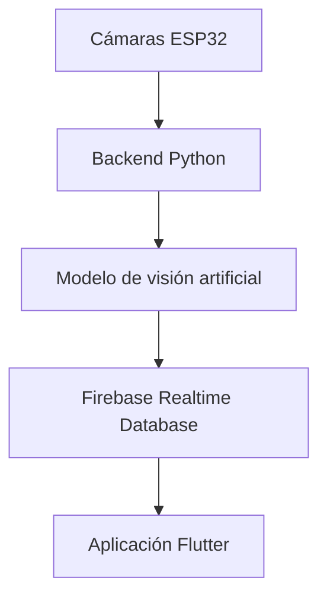

# ParkingIA

ParkingIA es un proyecto de parqueadero inteligente que busca detectar vehículos mediante cámaras, procesar la información con un backend en Python y mostrar en una aplicación Flutter la cantidad de cupos disponibles para carros y motos.

> **Estado actual:** en desarrollo. La aplicación Flutter y la estructura de Firebase Realtime Database ya existen. La inicialización de Firebase está implementada y se corrigió un error en la referencia de la base de datos, pero la lectura y la actualización en tiempo real todavía deben validarse completamente.

## Objetivo

Construir un sistema que permita:

- Detectar la entrada, salida u ocupación de vehículos mediante cámaras.
- Clasificar carros y motos utilizando un modelo de visión artificial.
- Calcular los cupos ocupados y disponibles.
- Guardar el estado actual del parqueadero en Firebase Realtime Database.
- Mostrar los cupos en una aplicación móvil desarrollada con Flutter.
- Actualizar la interfaz automáticamente cuando cambie el estado del parqueadero.

## Configuración entre firebase y flutter

La documentacion para configurar flutter con la base de datos de tipo Realtime database de firebase se hace aqui:

```text
https://app.notion.com/p/ParkingIA-Conexi-n-de-Flutter-con-Firebase-Realtime-Database-3dff3edcd6668153b0c8f2de3cda284d?source=copy_link
```

## Arquitectura prevista



En la etapa actual se está trabajando principalmente en la conexión:

```text
Firebase Realtime Database → Aplicación Flutter
```

Los componentes de cámaras, backend y modelo pertenecen al alcance reconstruido del proyecto, pero su implementación actual todavía debe recuperarse o verificarse.

## Tecnologías

- Flutter y Dart para la aplicación móvil.
- Firebase Core para inicializar Firebase.
- Firebase Realtime Database para almacenar y sincronizar el estado.
- Python para el backend de procesamiento, pendiente de recuperar o reconstruir.
- Cámaras ESP32 programadas con Arduino, pendientes de recuperar o reconstruir.
- Modelo de visión artificial para reconocer carros y motos, cuya herramienta de entrenamiento aún no ha sido identificada.

## Estructura actual de Firebase

La base de datos contiene dos nodos principales:

```text
config
├── cooldownMs: 2000
├── cuposMaxCarro: 100
├── cuposMaxMoto: 200
└── umbral: 0.85

estado
├── dispCarro: 91
├── dispMoto: 4
├── ocupadosCarro: 9
├── ocupadosMoto: 196
└── updatedAt: 0
```

### Nodo `config`

Contiene parámetros de operación del sistema:

- `cooldownMs`: tiempo mínimo entre eventos o actualizaciones.
- `cuposMaxCarro`: capacidad máxima para carros.
- `cuposMaxMoto`: capacidad máxima para motos.
- `umbral`: nivel de confianza mínimo esperado para aceptar una detección.

### Nodo `estado`

Contiene la información que consume la aplicación:

- `dispCarro`: cupos disponibles para carros.
- `dispMoto`: cupos disponibles para motos.
- `ocupadosCarro`: cupos ocupados por carros.
- `ocupadosMoto`: cupos ocupados por motos.
- `updatedAt`: fecha o marca de tiempo de la última actualización.

La URL utilizada actualmente es:

```text
https://parkingia-default-rtdb.firebaseio.com
```

## Configuración de FlutterFire

### 1. Verificar Firebase CLI

```bash
firebase --version
```

Si no está instalada:

```bash
npm install -g firebase-tools
firebase login
```

### 2. Instalar FlutterFire CLI

```bash
dart pub global activate flutterfire_cli
```

### 3. Agregar dependencias

```bash
flutter pub add firebase_core
flutter pub add firebase_database
flutter pub get
```

### 4. Configurar el proyecto Android

Desde la raíz del proyecto Flutter:

```bash
flutterfire configure --project=parkingia --platforms=android
```

Este comando genera o actualiza:

```text
lib/firebase_options.dart
```

No se recomienda modificar ese archivo manualmente como solución definitiva.

## Inicialización de Firebase

El archivo `main.dart` debe inicializar Firebase antes de crear la interfaz:

```dart
import 'package:flutter/material.dart';
import 'package:firebase_core/firebase_core.dart';

import 'firebase_options.dart';
import 'parking_station.dart';

Future<void> main() async {
  WidgetsFlutterBinding.ensureInitialized();

  await Firebase.initializeApp(
    options: DefaultFirebaseOptions.currentPlatform,
  );

  runApp(const MyApp());
}

class MyApp extends StatelessWidget {
  const MyApp({super.key});

  @override
  Widget build(BuildContext context) {
    return MaterialApp(
      debugShowCheckedModeBanner: false,
      title: 'ParkingIA',
      theme: ThemeData(
        colorScheme: ColorScheme.fromSeed(
          seedColor: const Color.fromARGB(255, 25, 8, 54),
        ),
      ),
      home: const ParkingStation(),
    );
  }
}
```

## Lectura actual de cupos disponibles

La prueba inicial consulta el valor:

```text
estado/dispCarro
```

La instancia y su referencia deben crearse de esta forma:

```dart
late final FirebaseDatabase database;
late final DatabaseReference databaseRef;

@override
void initState() {
  super.initState();

  database = FirebaseDatabase.instanceFor(
    app: Firebase.app(),
    databaseURL: 'https://parkingia-default-rtdb.firebaseio.com',
  );

  databaseRef = database.ref();
  obtenerDatos();
}
```

La lectura de prueba es:

```dart
Future<void> obtenerDatos() async {
  try {
    final snapshot =
        await databaseRef.child('estado/dispCarro').get();

    if (!mounted) return;

    if (snapshot.exists) {
      final valor = snapshot.value;

      setState(() {
        carrosDisponibles = (valor as num).toInt();
      });

      debugPrint('Valor recibido desde Firebase: $valor');
    } else {
      debugPrint('No se encontraron datos.');
    }
  } catch (error) {
    debugPrint('ERROR FIREBASE: $error');
  }
}
```

## Error identificado y corrección

Durante la conexión apareció el siguiente error:

```text
Database connection was forcefully killed by the server.
Will not attempt reconnect.
Reason: Firebase error.
Please ensure that you have the URL of your Firebase Realtime Database
instance configured correctly.
```

Se estaba creando una instancia con la URL correcta:

```dart
final FirebaseDatabase database = FirebaseDatabase.instanceFor(
  app: Firebase.app(),
  databaseURL: 'https://parkingia-default-rtdb.firebaseio.com',
);
```

Pero la referencia se obtenía desde otra instancia:

```dart
final DatabaseReference databaseRef =
    FirebaseDatabase.instance.ref();
```

La corrección es construir la referencia desde la instancia configurada:

```dart
databaseRef = database.ref();
```

## Inconsistencia adicional encontrada

En `firebase_options.dart` aparecieron valores de ParkingIA:

```dart
projectId: 'parkingia',
databaseURL: 'https://parkingia-default-rtdb.firebaseio.com',
```

pero `storageBucket` apuntaba al proyecto `blog-santox`. Aunque esto no explica directamente el error de Realtime Database, indica que la configuración pudo haberse mezclado con otro proyecto.

La solución propuesta es regenerar la configuración:

```bash
flutterfire configure --project=parkingia --platforms=android
```

También se debe confirmar que `android/app/google-services.json` contiene el `project_id`, `project_number` y `mobilesdk_app_id` de ParkingIA.

## Ejecución

Después de regenerar la configuración, realizar un reinicio completo:

```bash
flutter clean
flutter pub get
flutter run
```

No es suficiente usar únicamente hot reload cuando se cambia la configuración de Firebase.

## Prueba mediante REST

Abrir esta dirección en el navegador:

```text
https://parkingia-default-rtdb.firebaseio.com/estado.json
```

Resultados posibles:

- Si devuelve el objeto `estado`, la URL existe y la lectura está permitida.
- Si devuelve `Permission denied`, la URL es correcta, pero las reglas bloquean el acceso.
- Si informa que la instancia no existe, se debe verificar la URL exacta en Firebase Console.

## Siguiente paso: actualización en tiempo real

El método `.get()` lee los datos una sola vez. Para escuchar cambios automáticamente se utilizará `.onValue`:

```dart
final DatabaseReference estadoRef = database.ref('estado');

estadoRef.onValue.listen(
  (DatabaseEvent event) {
    debugPrint('DATOS: ${event.snapshot.value}');
  },
  onError: (Object error) {
    debugPrint('ERROR RTDB: $error');
  },
);
```

La prueba de aceptación será:

1. Ejecutar la aplicación.
2. Confirmar que muestra el valor actual de `dispCarro`.
3. Cambiar manualmente el valor en Firebase, por ejemplo de `91` a `87`.
4. Verificar que Flutter muestre `87` sin reiniciar la aplicación.

## Seguridad

Durante una prueba aislada podrían utilizarse temporalmente reglas abiertas:

```json
{
  "rules": {
    ".read": true,
    ".write": true
  }
}
```

Estas reglas no deben permanecer en producción. La aplicación móvil debería tener únicamente los permisos necesarios, mientras que las escrituras del estado deberían quedar restringidas al backend autorizado.

No se deben publicar claves privadas, archivos de cuentas de servicio ni secretos en el repositorio. El archivo `firebase_options.dart` contiene configuración del cliente, pero las reglas y la autenticación siguen siendo responsables de proteger los datos.

## Estado de los componentes

| Componente | Estado | Observación |
|---|---|---|
| Aplicación Flutter | Creada | Abre `ParkingStation` como pantalla principal. |
| Firebase Core | Implementado | Se inicializa antes de `runApp`. |
| Realtime Database | Configurado parcialmente | Existen `config` y `estado`. |
| Lectura de `dispCarro` | Pendiente de validación | La referencia incorrecta ya fue corregida. |
| Actualización con `.onValue` | Pendiente | Se implementará después de validar `.get()`. |
| Reglas de seguridad | Pendiente | No deben quedar abiertas en producción. |
| Cámaras ESP32 | Pendiente de recuperación | Se conoce su función, no su implementación actual. |
| Backend Python | Pendiente de recuperación | Debe recibir o procesar las detecciones. |
| Modelo de IA | Pendiente de identificación | Falta determinar cómo fue entrenado y dónde están sus archivos. |

## Criterios para considerar terminada la conexión

- La aplicación lee `estado/dispCarro` sin errores.
- Los valores mostrados coinciden con Firebase Console.
- Un cambio en `estado` se refleja automáticamente en Flutter.
- `firebase_options.dart` y `google-services.json` pertenecen por completo a ParkingIA.
- Las reglas permiten solo las operaciones requeridas.
- Los errores de red y permisos se muestran de forma controlada en la interfaz.

## Trabajo pendiente

- [ ] Regenerar `firebase_options.dart` para ParkingIA.
- [ ] Revisar `google-services.json`.
- [ ] Ejecutar la prueba REST de `estado.json`.
- [ ] Validar la lectura de `estado/dispCarro`.
- [ ] Implementar la escucha de todo el nodo `estado` con `.onValue`.
- [ ] Crear un modelo Dart para los datos del parqueadero.
- [ ] Separar acceso a Firebase, modelos, pantallas y widgets.
- [ ] Definir autenticación y reglas de seguridad.
- [ ] Recuperar o reconstruir el backend Python.
- [ ] Identificar o volver a entrenar el modelo de visión artificial.
- [ ] Recuperar el código de las cámaras ESP32.
- [ ] Definir el formato de `updatedAt` y detectar datos desactualizados.

## Estructura sugerida para Flutter

Cuando la conexión mínima esté comprobada, el proyecto puede organizarse así:

```text
lib/
├── main.dart
├── firebase_options.dart
├── models/
│   └── parking_status.dart
├── services/
│   └── firebase_service.dart
├── screens/
│   └── parking_station.dart
└── widgets/
    ├── parking_counter.dart
    └── vehicle_card.dart
```

No conviene introducir esta separación antes de validar la conexión mínima, porque agregaría más puntos posibles de fallo durante el diagnóstico.

